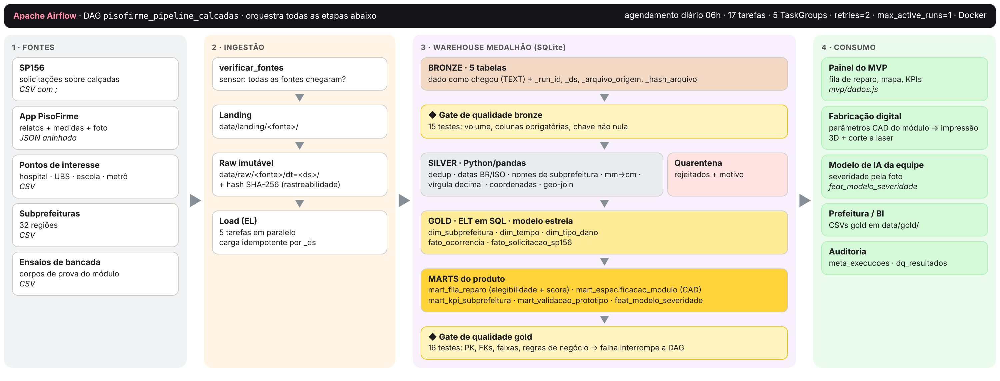
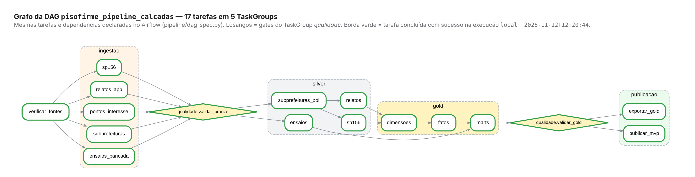

# PisoFirme SP — Pipeline de Dados do MVP CitizenTech

**Disciplina:** Big Data Architecture & Data Integration (2 de 7 · componente Dados)
**Professora:** Ana Machado
**Atividade:** Pipeline de Dados do MVP CitizenTech

## Integrantes

| Nome | RM |
|---|---|
| Vinicius Issa Gois | RM553814 |
| Gustavo Bonani | RM553493 |
| Wesley Vieira | RM553496 |
| Gustavo Felex | RM554242 |

---

## O projeto

O MVP da equipe propõe um **reparo modular temporário para calçadas**: uma estrutura celular com placa superior impressa em 3D, coberta por borracha natural cortada a laser, para buracos rasos e localizados.

Para que o módulo funcione como serviço, o produto precisa saber:

1. **quais** buracos cabem no escopo (cavidade rasa, dano localizado, base firme, sem tampa de serviço);
2. **quais** reparar primeiro (risco e exposição de pedestres);
3. **com que medidas** fabricar cada peça.

Este repositório tem o **pipeline orquestrado no Apache Airflow** que coleta, trata e modela esses dados e entrega ao MVP:

- **Fila de reparo priorizada** (`mart_fila_reparo`): elegibilidade ao módulo + score de 0 a 100 (severidade, proximidade de hospitais, escolas e metrô, recorrência e tempo de espera);
- **Especificação de cada módulo** (`mart_especificacao_modulo`): dimensões, altura da estrutura celular, número de peças pela mesa da impressora, filamento, tempo e custo estimados, parâmetros CAD;
- **Indicadores por subprefeitura** (`mart_kpi_subprefeitura`) e **validação do protótipo** (`mart_validacao_prototipo`);
- **Features para o modelo de IA** de severidade (`feat_modelo_severidade`);
- **Painel do MVP** (`mvp/index.html`), atualizado automaticamente a cada execução.

## Arquitetura



| Camada | O que acontece | Onde |
|---|---|---|
| Fontes | SP156 (CSV `;`), relatos do app (JSON aninhado), pontos de interesse, subprefeituras, ensaios de bancada | `data/landing/` |
| Ingestão (EL) | cópia imutável por data + hash SHA-256; carga "como veio" na bronze, idempotente por `_ds` | `pipeline/ingestao.py` |
| Bronze | 5 tabelas `bronze_*` (tudo TEXT) + colunas de linhagem | warehouse SQLite |
| Silver (ETL) | deduplicação, datas BR/ISO, nomes de subprefeitura, mm→cm, vírgula decimal, coordenadas, geo-join, quarentena | `pipeline/silver.py` |
| Gold (ELT) | modelo estrela + marts em SQL | `sql/gold/*.sql`, `pipeline/gold.py` |
| Qualidade | 31 testes (gates bronze e gold); falha crítica interrompe a DAG | `pipeline/qualidade.py` |
| Entrega | CSVs gold + `mvp/dados.js` para o painel | `pipeline/publicacao.py` |

### DAG `pisofirme_pipeline_calcadas`



- Agendamento diário às 06h (America/Sao_Paulo), `catchup=False`, `max_active_runs=1`, `retries=2`;
- 17 tarefas em TaskGroups: `ingestao` (5 em paralelo), `qualidade`, `silver`, `gold`, `publicacao`;
- O grafo é definido **uma vez** em `pipeline/dag_spec.py` e usado tanto pela DAG (`dags/pisofirme_pipeline_dag.py`) quanto pelo executor local (`run_local.py`).

### Por que os dados são simulados

O SP156 é uma fonte real, mas não traz as medidas do defeito (comprimento, largura, profundidade e firmeza da base), que são indispensáveis para decidir a elegibilidade e dimensionar a peça. Essas medidas viriam do app do MVP, que ainda não está em produção, e os ensaios do protótipo ainda serão feitos. Por isso, `scripts/gerar_dados_simulados.py` gera as 5 fontes com **semente fixa** (resultado reprodutível), imitando a estrutura real e **incluindo de propósito os problemas de dados reais**:

- 110 protocolos duplicados;
- nomes de subprefeitura em várias grafias;
- datas em dois formatos;
- 235 coordenadas inválidas;
- profundidades digitadas em mm;
- vírgula decimal;
- medidas negativas ou ausentes;
- relatos reenviados.

## Estrutura do repositório

```
dags/pisofirme_pipeline_dag.py   DAG do Airflow
pipeline/                        código das tarefas (ingestão, silver, gold, qualidade, publicação)
  dag_spec.py                    grafo de tarefas (fonte única)
  config.py                      caminhos, regras de elegibilidade, pesos do score, critérios de ensaio
sql/gold/                        transformações ELT da camada gold
data/landing/                    fontes de dados (entrada)
data/gold/                       tabelas gold exportadas em CSV (saída)
mvp/                             painel do MVP (index.html + dados.js gerado pelo pipeline)
docs/                            arquitetura, dicionário de dados, prints, PDF de entrega, log da execução
scripts/                         geração dos dados simulados e da documentação
tests/                           testes automatizados (pytest)
run_local.py                     executa a mesma DAG sem Airflow
docker-compose.yaml              Airflow pronto para rodar
```

## Como executar

### Opção A: Airflow com Docker (recomendado)

1. Instale o [Docker Desktop](https://www.docker.com/products/docker-desktop/) e deixe-o aberto.
2. No terminal, dentro da pasta do projeto, rode:
   ```bash
   docker compose up -d
   ```
3. Aguarde de 1 a 2 minutos e abra http://localhost:8080 (usuário `admin`, senha `admin`).
4. Abra a DAG `pisofirme_pipeline_calcadas` e clique em **▶ Trigger DAG**.
5. Acompanhe pela aba **Graph** (todas as tarefas devem ficar verdes) e veja os logs clicando em cada tarefa.
6. Abra `mvp/index.html` no navegador para ver o painel atualizado.

Para desligar: `docker compose down`.

### Opção B: local, sem Airflow (as mesmas tarefas e dependências)

```bash
pip install -r requirements.txt
python run_local.py            # ou: python run_local.py --ds 2026-11-12
```

### Testes

```bash
pytest -q
```

Os 9 testes cobrem o grafo da DAG, a limpeza de nomes e coordenadas, a execução ponta a ponta e a idempotência do reprocessamento.

### Regerar dados, prints e PDF

```bash
python scripts/gerar_dados_simulados.py
python run_local.py --ds 2026-11-12 > docs/execucao_pipeline.log 2>&1
python scripts/gerar_documentacao.py     # requer playwright + Chrome e Graphviz
```

## Documentação e evidências

- **PDF de entrega** (arquitetura + dicionário de dados + evidências): `docs/Entrega_PisoFirme_Pipeline.pdf`
- **Dicionário de dados:** [`docs/dicionario_dados.md`](docs/dicionario_dados.md)
- **Prints da execução:** `docs/prints/`
  - DAG executada no Airflow (aba Graph, 17/17 tarefas com sucesso) e log de tarefa no Airflow (`07_airflow_graph.png`, `08_airflow_log_tarefa.png`);
  - grafo da DAG;
  - logs;
  - dados carregados;
  - testes de qualidade;
  - amostra gold;
  - painel do MVP.
- **Log completo:** `docs/execucao_pipeline.log`

## Limites

- Os dados são simulados.
- Custo, massa e tempo de impressão são estimativas de projeto.
- Os ensaios de bancada não equivalem a certificação para uso em calçadas (conforme o documento de conceito da equipe).
